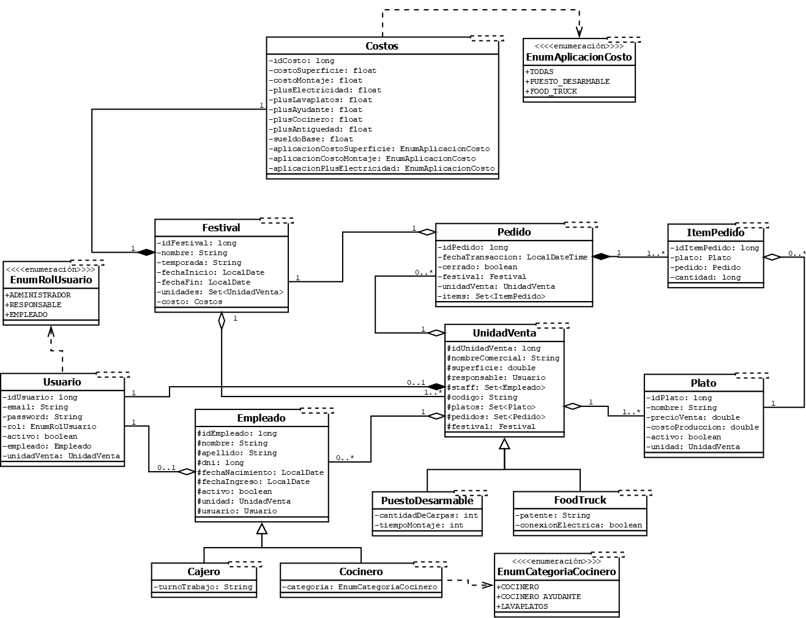

# Sistema de Gestión "Epicentro Gourmet"

Proyecto desarrollado para la asignatura [Orientación a Objetos 2] - [2026 - Segundo Cuatrimestre]. Esta es una aplicación web desarrollada con Spring Boot para administrar festivales temáticos, sus unidades de venta, empleados, platos y resultados económicos.

## Equipo

- **Número de grupo:** 11
- **Integrantes:**
  - Leal, Arian Gabriel — [@ari2709](https://github.com/ari2709)
  - Ledesma Miño, Alejandro Javier — [@AJLM97](https://github.com/AJLM97)
  - Boullon, Juan Bautista — [@JuanBa7](https://github.com/JuanBa7)
  - Vogt, Thomas Gebhard — [@Thomy98](https://github.com/Thomy98)

## Diagrama de clases



## Tecnologías y requisitos

- Java 21 o 25
- MySQL
- Maven

## Preparar y ejecutar la aplicación

1. Instalar Java 21 o 25 y MySQL, e iniciar el servidor de MySQL.
2. Crear la base de datos:

   ```sql
   CREATE DATABASE bd_tp_grupal_oo2_grupo11;
   ```

3. En la raíz del proyecto, crear un archivo `.env` con las credenciales locales. Este archivo está excluido de Git:

   ```properties
   DB_HOST=localhost:3306
   DB_NAME=bd_tp_grupal_oo2_grupo11
   DB_USER=root
   DB_PASS=tu_clave_de_mysql
   SMTP_USER=tu_correo@gmail.com
   SMTP_PASS=tu_clave_de_aplicacion
   ```

   `SMTP_USER` y `SMTP_PASS` se usan para enviar correos. Para Gmail, `SMTP_PASS` debe ser una contraseña de aplicación. La configuración de base de datos también tiene valores predeterminados en `application.yaml`, pero se recomienda usar los valores locales del `.env`.

4. Desde la raíz del proyecto, iniciar la aplicación:

   ```powershell
   .\mvnw.cmd spring-boot:run
   ```

5. Opcionalmente, para cargar los datos de demostración, se recomienda ejecutar el archivo:
    ```
    .\src\main\resources\db\seed.sql
    ``` 
    Recomendablemente desde MySQL Workbench o un programa similar.

## Casos de uso implementados y responsables

| Caso de uso | Funcionalidad | Responsable |
|---|---|---|
| `CUIniciarSesionAlejandroLedesma` | Inicio y cierre de sesión de usuarios. | Alejandro Javier Ledesma Miño ([@AJLM97](https://github.com/AJLM97)) |
| `CUGestionarAccesoPublicoAlejandroLedesma` | Consulta pública de festivales y acceso a la información disponible sin iniciar sesión. | Alejandro Javier Ledesma Miño ([@AJLM97](https://github.com/AJLM97)) |
| `CUGestionUnidadesDeVentaAlejandroLedesma` | Consulta y administración de unidades de venta asociadas a festivales. | Alejandro Javier Ledesma Miño ([@AJLM97](https://github.com/AJLM97)) |
| `CUGestionEmpleadoAlejandroLedesma` | Alta, consulta, actualización y baja de empleados de una unidad. | Alejandro Javier Ledesma Miño ([@AJLM97](https://github.com/AJLM97)) |
| `CUConsultarRankingUnidadesAlejandroLedesma` | Ranking de unidades de venta por recaudación dentro de un festival. | Alejandro Javier Ledesma Miño ([@AJLM97](https://github.com/AJLM97)) |
| `CUReporteMayoresCanonAlejandroLedesma` | Consulta de las unidades con mayor canon de un festival. | Alejandro Javier Ledesma Miño ([@AJLM97](https://github.com/AJLM97)) |
| `CUPlatoEstrellaThomasVogt` | Identifica el plato con mayor cantidad de unidades vendidas. | Thomas Gebhard Vogt ([@Thomy98](https://github.com/Thomy98)) |
| `CURentabilidadNetaThomasVogt` | Cálculo de rentabilidad neta de una unidad, considerando ventas, costos, sueldos y canon. | Thomas Gebhard Vogt ([@Thomy98](https://github.com/Thomy98)) |
| `CUReporteRecaudacionThomasVogt` | Reportes de recaudación de la unidad y sus pedidos cerrados. | Thomas Gebhard Vogt ([@Thomy98](https://github.com/Thomy98)) |
| `CULiquidacionHaberesThomasVogt` | Cálculo y consulta de liquidaciones de haberes del personal. | Thomas Gebhard Vogt ([@Thomy98](https://github.com/Thomy98)) |
| `CUCalculoCanonThomasVogt` | Cálculo del canon de una unidad con su desglose de costos. | Thomas Gebhard Vogt ([@Thomy98](https://github.com/Thomy98)) |
| `CUGestionPedidosThomasVogt` | Gestión de pedidos y sus ítems por parte del personal de la unidad. | Thomas Gebhard Vogt ([@Thomy98](https://github.com/Thomy98)) |
| `CUGestionarPlatosThomasVogt` | Alta, consulta, actualización y baja de platos de una unidad. | Thomas Gebhard Vogt ([@Thomy98](https://github.com/Thomy98)) |
| `CUGestionarFestivalesThomasVogt` | Alta, consulta, actualización y baja de festivales. | Thomas Gebhard Vogt ([@Thomy98](https://github.com/Thomy98)) |

## Casos de uso personales y responsables

| Caso de uso | Funcionalidad | Responsable |
|---|---|---|
| `CUAuditoriaPedidosThomasVogt` | Consulta y auditoría de pedidos de una unidad. | Thomas Gebhard Vogt ([@Thomy98](https://github.com/Thomy98)) |
| `CUPuntoEquilibrioThomasVogt` | Cálculo del punto de equilibrio de una unidad de venta. | Thomas Gebhard Vogt ([@Thomy98](https://github.com/Thomy98)) |
| `CUConsultarPlatosMasRentablesAlejandroLedesma` | Lista platos ordenados por rentabilidad en una unidad de venta. | Alejandro Javier Ledesma Miño ([@AJLM97](https://github.com/AJLM97)) |
| `CURankingConcurrenciaPorTemporadaAlejandroLedesma` | Ranking de festivales por temporada según pedidos cerrados, usados como estimación de concurrencia; muestra también el año del festival. | Alejandro Javier Ledesma Miño ([@AJLM97](https://github.com/AJLM97)) |
